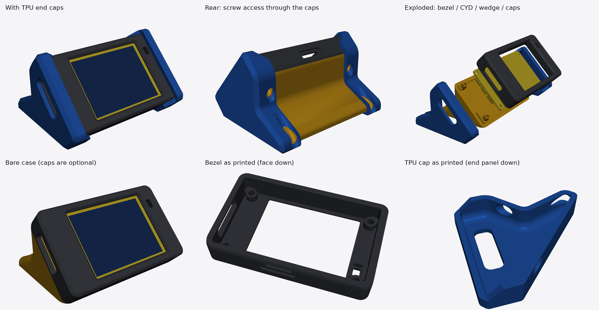
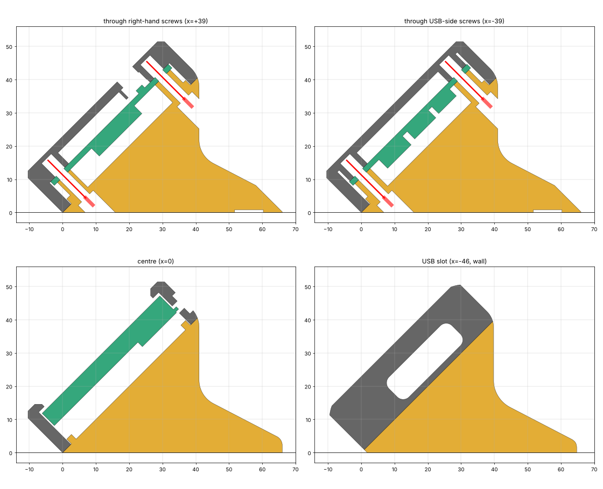

# ESP32-2432S028R (CYD2USB) 45° Desk Enclosure

A sturdy, support-free desk enclosure for the **ESP32-2432S028R "Cheap Yellow Display"**, dual-USB revision (micro-USB + USB-C, often called *CYD2USB*). The screen sits in landscape at 45°. The case is two PLA parts plus optional TPU end caps that act as bumpers and non-slip feet.



## Features

- **45° landscape desk wedge.** It's stable to use: it only tips back if the top edge of the screen is pressed with about 1 kgf.
- **Prints without supports**: the bezel prints face down, the wedge on its flat base.
- **Hidden screws:** four M3 screws go in from underneath and the back, into heat-set inserts. A self-tapping version is also included.
- **Recessed screen:** the bezel stands 3.5 mm proud of the glass. A 1 mm air gap means the bezel never presses on the resistive touch panel, so it doesn't cause phantom touches.
- **Firmly mounted board:** the PCB is clamped at all four mounting holes, and a locating ridge keys the two halves together.
- **Light sensor (LDR) window** with a baffle so the backlight doesn't fool the auto-brightness.
- **Port access:** USB-C and micro-USB at the left end, and microSD at the top-back edge with a fingernail pocket.
- **Optional TPU end caps:** they cover all eight corners, and their base strips work as grippy feet.

| | Size (W × D × H) |
|---|---|
| Bare case | 96 × 76 × 51 mm |
| With TPU caps | 102 × 82 × 57 mm |

## Compatibility

The case is designed for the **dual-USB ESP32-2432S028R (CYD2USB)**. The single-micro-USB original CYD has the same outline and hole pattern, so it should fit too, but that hasn't been tested.

The exact USB-C and micro-USB positions aren't published for the dual-USB board. The USB end therefore has one generous slot (26.8 × 8.5 mm). Please print the fit-test piece first (see below).

## Files

| File | Material | Print orientation |
|---|---|---|
| `CYD2USB_wedge_front_bezel_heatset.stl` | PLA | Face down (as exported) |
| `CYD2USB_wedge_front_bezel_selftap.stl` | PLA | Face down. Use instead of the heat-set version if you have no inserts |
| `CYD2USB_wedge_rear_wedge.stl` | PLA | On its flat base (as exported) |
| `CYD2USB_wedge_fit_test_usb_end.stl` | PLA | Face down. A 15-minute check of the USB slot |
| `CYD2USB_wedge_tpu_cap_usb_end.stl` | TPU | End panel down (as exported). Has the USB opening |
| `CYD2USB_wedge_tpu_cap_sensor_end.stl` | TPU | End panel down (as exported) |
| `CYD2USB_wedge_assembly.step` | — | Assembled model for CAD |
| `cyd_wedge_case.py` | — | Parametric CadQuery source for everything above |

## Bill of materials

| Qty | Part | Notes |
|---|---|---|
| 4 | M3 × 16 socket-head screw (ISO 4762 / DIN 912) | M3 × 14 also works. **Don't use anything longer than 16 mm**, or it will push through the bezel face |
| 4 | M3 heat-set insert, 4 or 5.7 mm long, OD 4.5–5 mm | Hole is 4.1 mm. Not needed for the self-tap bezel |
| 4 | Stick-on rubber feet, Ø10 mm | Optional if you use the TPU caps |
| ~90 g | PLA (PLA+, PETG or ASA also work) | Bezel ≈ 25 g, wedge ≈ 60 g |
| ~35 g | TPU 95A | For the two end caps |

## Printing

### PLA parts

| Setting | Value |
|---|---|
| Layer height | 0.2 mm |
| Walls | 6 (the bezel walls come out solid) |
| Top / bottom layers | 6 / 6 |
| Infill (wedge) | 35 % gyroid |
| Nozzle temperature | Upper end of your filament's range, for strong layer bonding |
| Supports | None |

### TPU end caps

| Setting | Value |
|---|---|
| Material | TPU 95A |
| Layer height | 0.2 mm |
| Walls / infill | 4 walls, 100 % infill (the caps are thin, so this keeps them solid) |
| Speed | 20–30 mm/s |
| Supports | None. Print with the flat end panel on the bed |

The caps are a stretch fit: their inside is modelled 0.15 mm smaller than the case. If they come out too tight or too loose on your printer, scale the cap's X/Y by ±0.5 % in your slicer.

## Before you print: USB fit test

1. Print `CYD2USB_wedge_fit_test_usb_end.stl`. It's the USB end of the bezel and takes about 15 minutes.
2. Set the USB end of your board into it, screen side down. The two mounting holes should line up with the two bosses.
3. Plug in a USB-C and a micro-USB cable. Both should seat fully without the plug bodies hitting the slot.

If they don't fit, adjust `USB_Y0`, `USB_Y1`, `USB_Z0` and `USB_Z1` in `cyd_wedge_case.py` and regenerate (see [Customising](#customising)).

## Assembly



1. **Inserts:** press the four heat-set inserts into the bezel bosses with a soldering iron (about 220 °C for PLA) until they're flush.
2. **Board:** lay the bezel face down. Place the CYD screen first, with the USB ports at the slot end. The light sensor sits under the small rectangular window.
3. **Wedge:** lower the wedge onto the back of the board. The ridge slides inside the bezel walls, and the posts land on the PCB mounting holes.
4. **Screws:** drive two screws from underneath and two from the vertical back face, through the posts and PCB into the inserts. Tighten until snug and no further.
5. **Caps or feet:** stretch the TPU caps over each end; the cap with the slot goes on the USB end. The screw heads stay reachable through holes in the caps. If you don't use the caps, stick rubber feet into the four recesses on the base.

On the desk the USB ports are on the **left**. If your UI shows upside down, swap `setRotation(1)` and `setRotation(3)`.

## Customising

Everything is generated by `cyd_wedge_case.py` ([CadQuery](https://cadquery.readthedocs.io/)):

```bash
pip install cadquery trimesh
python3 cyd_wedge_case.py
```

Useful parameters at the top of the file:

| Parameter | What it controls |
|---|---|
| `USB_Y0`, `USB_Y1`, `USB_Z0`, `USB_Z1` | USB slot position and size |
| `SD_X0`, `SD_X1`, `SD_Z0`, `SD_Z1` | microSD slot position and size |
| `DISP_TOP`, `FACE_IN` | Display height and the air gap above it |
| `INSERT_D`, `SELFTAP_D` | Insert hole and self-tap pilot hole diameters |
| `HEEL_Y` | Base depth (stability against tipping) |
| `CAP_T`, `CAP_LIP`, `CAP_FACE_LIP`, `CAP_GRIP` | TPU cap thickness, wrap-around and fit |

## Notes and limitations

- **Not reachable once assembled:**
  - the **BOOT/RESET buttons**. Normal USB flashing doesn't need them, because the board auto-resets; unplug USB to power-cycle.
  - the **side JST connectors** (serial/power, extended IO, CN1, speaker).
  - the **RGB LED** on the back.
- **USB-C power:** the USB-C port on the CYD2USB has no CC resistors, so USB-C-to-C cables often don't power it. Use a USB-A-to-C cable, or the micro-USB port.
- **Heat:** PLA softens above about 55 °C, so don't leave the case in a hot car or in direct sun behind glass.
- **Drop resistance:** the case is built to take everyday knocks, but it hasn't been formally drop-tested.

## Design references

- ESP32-2432S028R specification and dimension drawing, and the JC2432A028N LCD datasheet (Shenzhen Jingcai Intelligent). These are mirrored in [witnessmenow/ESP32-Cheap-Yellow-Display](https://github.com/witnessmenow/ESP32-Cheap-Yellow-Display).
- The screen window and light-sensor positions were cross-checked against the community cases in that repository.

This project is not affiliated with the board's manufacturer.

## Contributing

Issues and pull requests are welcome. These would be especially useful:

- **Measured USB port positions** for your board revision, so the USB slot can be tightened.
- Photos of your print, and notes on what fit and what didn't.
- Variants: a cable exit for the JST connectors, button access, other tilt angles.

## License

- **3D models, images and documentation:** © 2026 Syed Abdul Waheed, licensed under [CC BY-NC-SA 4.0](https://creativecommons.org/licenses/by-nc-sa/4.0/); see [`LICENSE`](LICENSE). You can share and remix them for non-commercial purposes, with attribution, under the same license.
- **Source code** (`cyd_wedge_case.py`): © 2026 Syed Abdul Waheed, licensed under the [MIT License](LICENSE-MIT).
